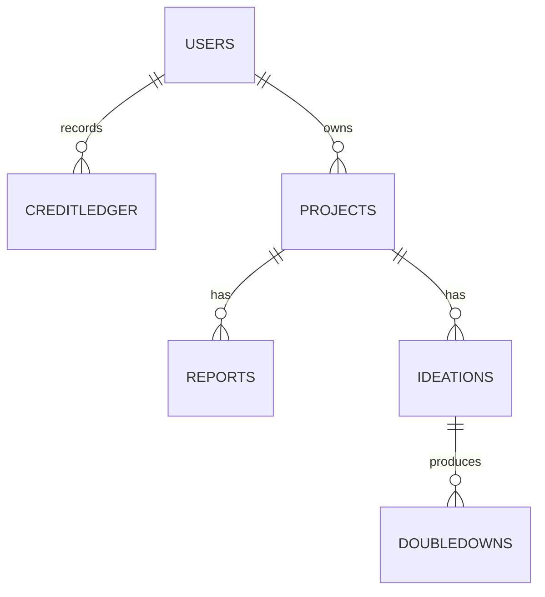

# Data Layer – V2 Platform

This document captures the DynamoDB and S3 schema used by the credits driven
research & ideation platform.  It mirrors the `V2_FEATURES.md` Data Layer
specification and adds access patterns, IAM notes and initialization guidance.

## DynamoDB Tables

### Users
| Attribute | Type | Notes |
|-----------|------|-------|
| `userId` | S | Cognito `sub`, primary key |
| `email` | S | from ID token |
| `credits` | N | pooled integer balance |
| `stats` | M | `{ reportCount, ideationCount, doubleDownCount }` |
| `stripeCustomerId` | S | optional |
| `entity` | S | constant `'USERS'` for admin GSI |
| `createdAt` | N | epoch ms |
| `updatedAt` | N | epoch ms |

*GSI:* **`GSIUsersByCreated`** → `PK: entity` (`'USERS'`), `SK: createdAt`

### CreditLedger
| Attribute | Type | Notes |
|-----------|------|-------|
| `userId` | S | partition key |
| `txId` | S | sort key, idempotent |
| `type` | S | `credit` \| `debit` |
| `amount` | N | always `1` |
| `reason` | S | `purchase`, `report`, `ideation`, `double_down`, `refund`, `manual_adjust:<note>` |
| `ts` | N | epoch ms |
| `meta` | M | optional metadata |

*GSIs:* **`GSI_LedgerByTime`** (`PK: userId`, `SK: ts`),
**`GSI_LedgerGlobal`** (`PK: reason`, `SK: ts`)

### Projects
| Attribute | Type | Notes |
|-----------|------|-------|
| `projectId` | S | primary key |
| `userId` | S | owner |
| `title` | S | |
| `domain` | S | optional |
| `inputs` | M | seed inputs / settings |
| `createdAt` | N | epoch ms |

*GSI:* **`GSI_ProjectsByUser`** (`PK: userId`, `SK: createdAt`)

### Reports
| Attribute | Type | Notes |
|-----------|------|-------|
| `reportId` | S | primary key |
| `projectId` | S | |
| `userId` | S | |
| `status` | S | `pending`, `done`, `failed` |
| `reportS3Key` | S | set when done |
| `startedAt` | N | epoch ms |
| `completedAt` | N | epoch ms |

*GSI:* **`GSI_ReportsByProject`** (`PK: projectId`, `SK: startedAt`)

### Ideations
| Attribute | Type | Notes |
|-----------|------|-------|
| `ideationId` | S | primary key |
| `projectId` | S | |
| `userId` | S | |
| `reportId` | S | source report |
| `status` | S | `pending`, `done`, `failed` |
| `ideasJsonS3Key` | S | S3 JSON blob |
| `startedAt` | N | epoch ms |
| `completedAt` | N | epoch ms |

*GSI:* **`GSI_IdeationsByProject`** (`PK: projectId`, `SK: startedAt`)

### DoubleDowns
| Attribute | Type | Notes |
|-----------|------|-------|
| `doubleId` | S | primary key |
| `projectId` | S | |
| `userId` | S | |
| `ideationId` | S | |
| `ideaId` | S | target idea within ideation |
| `feedback` | S | user provided |
| `status` | S | `pending`, `done`, `failed` |
| `finalPdfS3Key` | S | |
| `finalZipS3Key` | S | |
| `startedAt` | N | epoch ms |
| `completedAt` | N | epoch ms |

*GSI:* **`GSI_DoublesByProject`** (`PK: projectId`, `SK: startedAt`)

### Relationships


## S3 Artifacts Bucket
`/u/{userId}/p/{projectId}/`
```
report/{reportId}/report.pdf
ideation/{ideationId}/ideas.json
double/{doubleId}/final.pdf
double/{doubleId}/provisional_package.zip
double/{doubleId}/sb16.pdf
double/{doubleId}/drawings.pdf
```
Objects are private and accessed through presigned URLs.

## Access Patterns
- **User lookup:** `Users` table by `userId`.
- **Admin list users:** query `GSIUsersByCreated` with `entity='USERS'`.
- **Ledger by time:** query `GSI_LedgerByTime` for a user's history.
- **Global ledger stream:** query `GSI_LedgerGlobal` by `reason`.
- **Projects for user:** query `GSI_ProjectsByUser` most-recent-first.
- **Reports/Ideations/DoubleDowns by project:** query their respective GSIs.

## Invariants
- `Users.credits` is the single pooled balance.
- Every debit/credit operation must create a `CreditLedger` item.
- Starting an action (report/ideation/double-down) performs: debit, create action item, increment user counters.
- Referential checks:
  - `Ideations.reportId` exists and matches `userId`/`projectId`.
  - `DoubleDowns.ideationId` exists and `ideaId` is present in that ideation's JSON.

## IAM & Secrets
- Lambdas are granted table-scoped read/write and S3 object access.
- Admin Lambdas may read all tables with optional write for credit adjustments.
- Secrets stored in Parameter Store / Secrets Manager:
  - `STRIPE_SECRET_KEY`
  - `STRIPE_WEBHOOK_SECRET`
  - `STRIPE_PRICE_CREDIT`
- Environment variables expose table names, bucket name and secret parameter paths.

## Initialization / Migration
1. Create all tables and the `ArtifactsBucket` using the CDK stack.
2. For existing users, seed items with:
   ```json
   { "userId": "<sub>", "credits": 0, "entity": "USERS", "stats": {"reportCount":0,"ideationCount":0,"doubleDownCount":0} }
   ```
3. Ensure new user registration process inserts `entity='USERS'` and `credits=0` by default.

