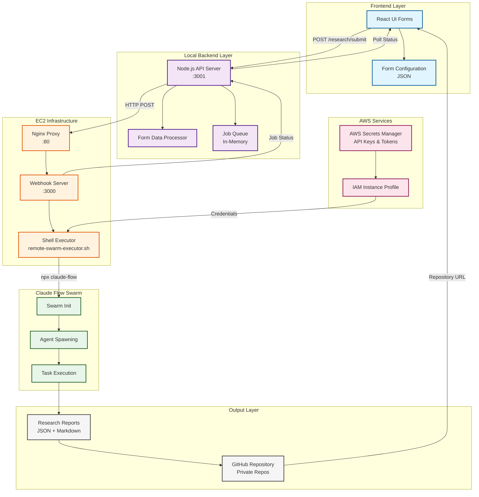
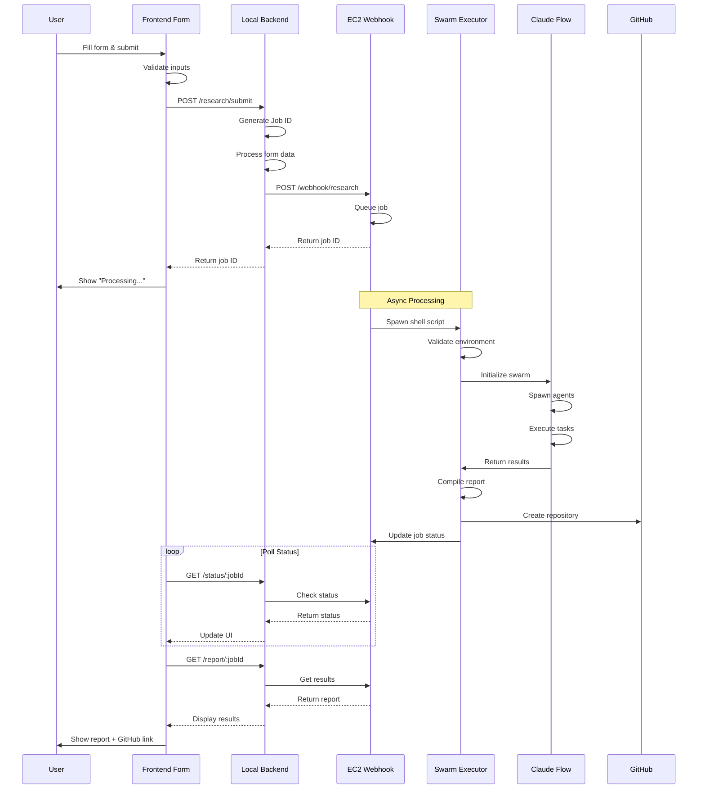
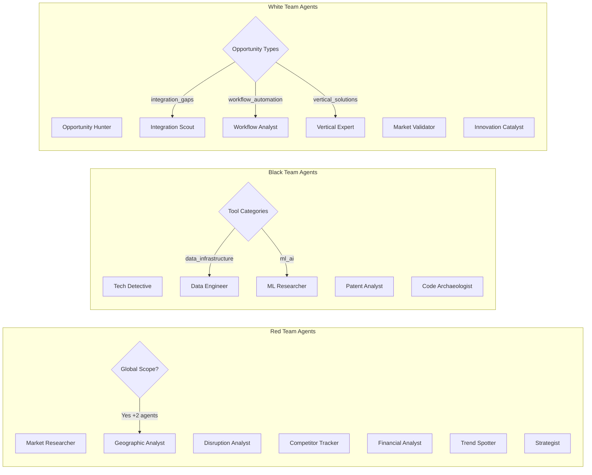
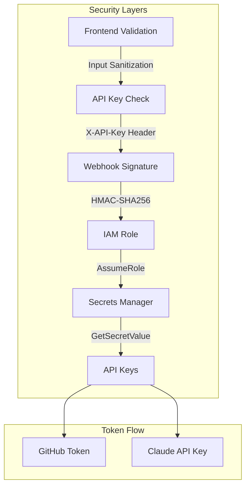
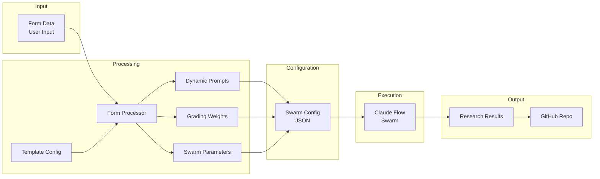
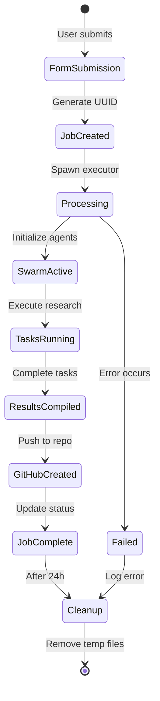
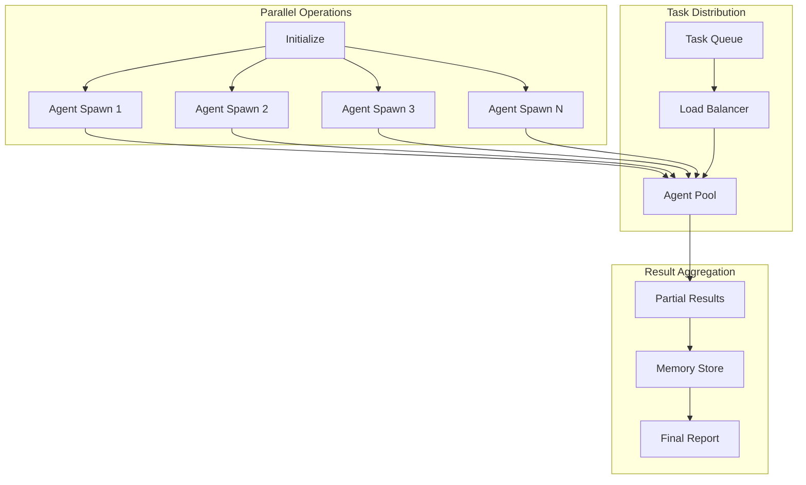
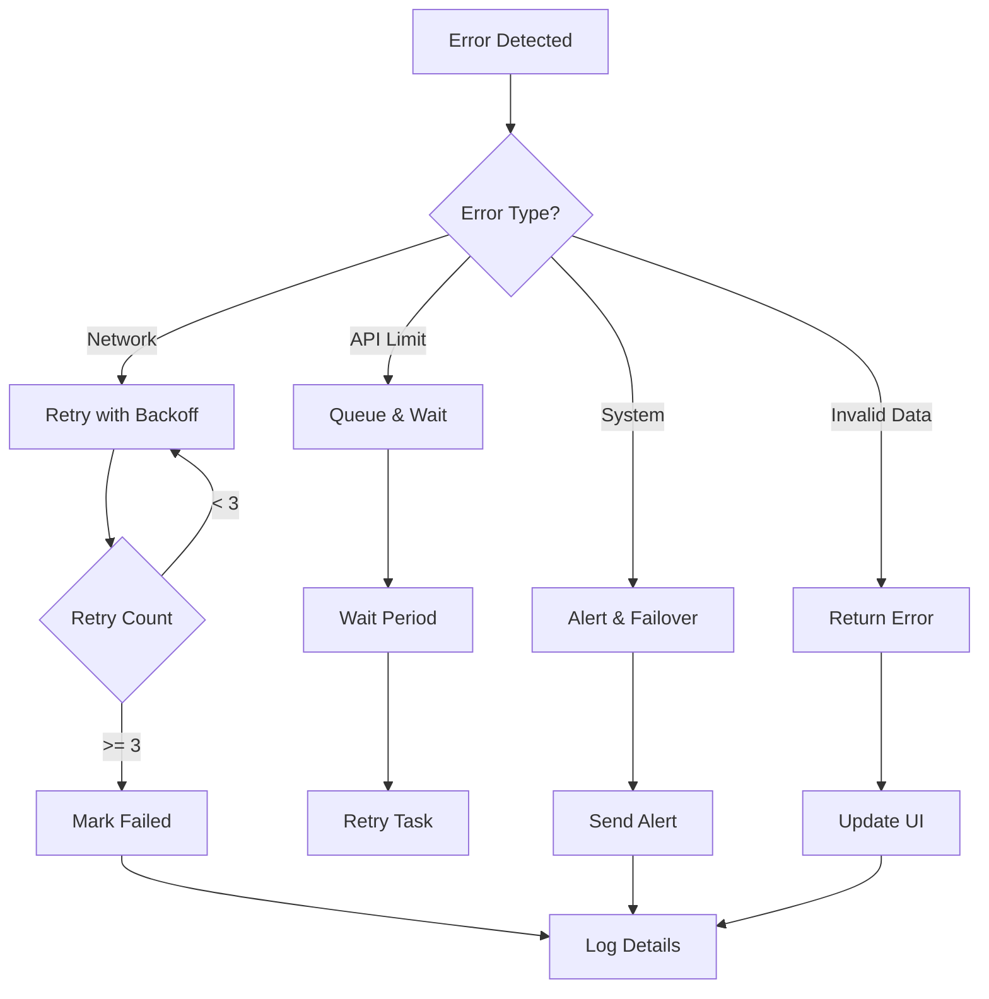
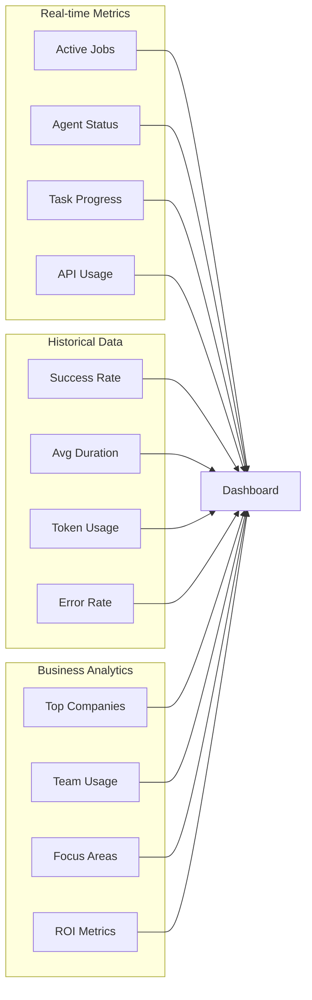

# EC2 Integration Flow Diagram

## Complete Data Flow Architecture

## Form Submission Sequence

## Agent Spawning Logic by Team Type

## Security Flow

## Data Transformation Pipeline

## Resource Lifecycle

## Performance Optimization Flow

## Error Handling & Recovery

## Monitoring Dashboard Components

