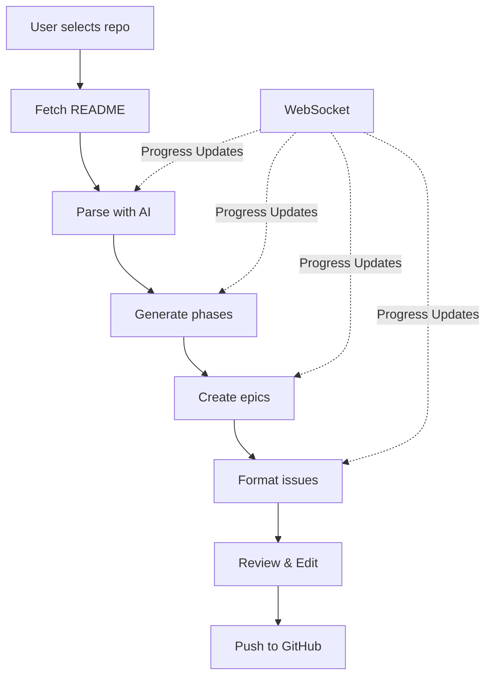

# Agent Team Composer - PLAN Tab Integration Design

## Executive Summary

This document outlines the integration of the Agent Team Composer functionality into the existing Color Code Research Hub as a new PLAN tab. The integration will provide a web UI for listing GitHub repositories, selecting repos, displaying milestones interactively, and running the CLI tool to generate project plans.

## 1. Architecture Overview

### 1.1 Current State
- **Color Code Research Hub**: React app with Red/Black/White team pages
- **Agent Team Composer**: Standalone web-based tool that transforms README files into GitHub project plans
- **Infrastructure**: AWS SAM with API Gateway and Lambda functions

### 1.2 Target State
- Add tabbed interface with RESEARCH, PLAN, and BUILD tabs
- PLAN tab integrates Agent Team Composer functionality
- Seamless integration with existing Amplify deployment

## 2. UI Design

### 2.1 Tab Navigation
```
┌─────────────────────────────────────────────────────────┐
│  Color Code Research Hub                                 │
├─────────────────────────────────────────────────────────┤
│  [RESEARCH]  [PLAN]  [BUILD]                           │
├─────────────────────────────────────────────────────────┤
│                                                         │
│  Tab Content Area                                       │
│                                                         │
└─────────────────────────────────────────────────────────┘
```

### 2.2 PLAN Tab Features
1. **Repository Listing**
   - List all repositories accessible via GitHub PAT
   - Search/filter capabilities
   - Display repo metadata (stars, last updated, description)

2. **Repository Selection**
   - Click to select repository
   - Display README preview
   - Show parsing results

3. **Milestone Generation**
   - Interactive phase selection
   - Edit/customize generated phases
   - Preview epics and issues

4. **Progress Tracking**
   - Real-time progress during generation
   - Step indicators
   - Error handling and retry

5. **Results Display**
   - Generated milestones, epics, and issues
   - Export options
   - Direct GitHub integration

## 3. Component Architecture

### 3.1 New Components

```typescript
// Main tab container
PlanTab.tsx
├── RepoSelector.tsx        // GitHub repository listing
├── RepoDetails.tsx         // Selected repo info + README
├── PhaseGenerator.tsx      // Phase generation UI
├── EpicManager.tsx         // Epic creation and editing
├── IssueFormatter.tsx      // Issue formatting and preview
├── ProgressTracker.tsx     // Real-time progress display
└── ResultsView.tsx         // Final results display
```

### 3.2 Reusable Components from Agent Team Composer
- `ParseProduct.tsx` - README parsing UI
- `LifecyclePhases.tsx` - Phase management
- `EpicIssueView.tsx` - Epic and issue display
- `ReviewSubmit.tsx` - Final review and submission

### 3.3 Shared UI Components
- Use existing shadcn/ui components
- Maintain consistent styling with existing app

## 4. Backend Integration

### 4.1 New Lambda Functions

```yaml
# GitHub Repository Function
GitHubRepoFunction:
  Handler: githubRepo.handler
  Events:
    - GET /api/github/repos
    - GET /api/github/repos/{owner}/{repo}
    - GET /api/github/repos/{owner}/{repo}/readme

# CLI Execution Function  
AgentComposerFunction:
  Handler: agentComposer.handler
  Events:
    - POST /api/agent-composer/generate
    - GET /api/agent-composer/status/{jobId}
    - GET /api/agent-composer/results/{jobId}

# WebSocket for Progress
ProgressWebSocket:
  Handler: progress.handler
  Events:
    - $connect
    - $disconnect
    - sendProgress
```

### 4.2 API Endpoints

```typescript
// GitHub Integration
GET  /api/github/repos                    // List user repositories
GET  /api/github/repos/:owner/:repo       // Get repo details
GET  /api/github/repos/:owner/:repo/readme // Get README content

// Agent Composer Integration
POST /api/agent-composer/generate          // Start generation job
GET  /api/agent-composer/status/:jobId     // Check job status
GET  /api/agent-composer/results/:jobId    // Get generation results

// Progress Updates (WebSocket)
WS   /ws/progress/:jobId                   // Real-time progress updates
```

### 4.3 Environment Variables
```bash
GITHUB_TOKEN=ghp_xxx              # GitHub PAT for API access
ANTHROPIC_API_KEY=sk-ant-xxx      # Claude API key
WEBSOCKET_API_URL=wss://xxx       # WebSocket endpoint
```

## 5. Data Flow



## 6. Integration Steps

### 6.1 Frontend Integration
1. Add tab navigation to main App.tsx
2. Create /plan route
3. Port Agent Team Composer components
4. Integrate with existing state management
5. Add progress tracking with WebSocket

### 6.2 Backend Integration
1. Create new Lambda functions
2. Update SAM template
3. Configure GitHub API integration
4. Implement job queue for long-running tasks
5. Add WebSocket for real-time updates

### 6.3 Deployment Updates
1. Update build scripts
2. Configure environment variables
3. Update CI/CD pipeline
4. Test in staging environment
5. Deploy to production

## 7. Key Algorithms to Port

### 7.1 README Parser
- Title extraction regex
- Feature detection patterns
- Tech stack identification
- Complexity assessment

### 7.2 Phase Generator
- 8 standard SDLC phases
- Context-aware customization
- Role assignment logic

### 7.3 Epic/Issue Formatter
- SPARC-ready formatting
- Label generation
- Dependency mapping

## 8. Progress Tracking Design

### 8.1 Progress States
```typescript
enum ProgressState {
  INITIALIZING = "Initializing",
  PARSING_README = "Parsing README",
  GENERATING_PHASES = "Generating phases",
  CREATING_EPICS = "Creating epics",
  FORMATTING_ISSUES = "Formatting issues",
  READY_FOR_REVIEW = "Ready for review",
  PUSHING_TO_GITHUB = "Pushing to GitHub",
  COMPLETED = "Completed",
  ERROR = "Error"
}
```

### 8.2 WebSocket Messages
```typescript
interface ProgressMessage {
  jobId: string;
  state: ProgressState;
  progress: number; // 0-100
  message: string;
  data?: any;
  error?: string;
}
```

## 9. Security Considerations

1. **API Authentication**
   - Validate GitHub PAT on backend
   - Never expose tokens to frontend
   - Use AWS Secrets Manager

2. **Rate Limiting**
   - Implement request throttling
   - Queue long-running jobs
   - Handle GitHub API limits

3. **Input Validation**
   - Sanitize README content
   - Validate repo access permissions
   - Prevent XSS in generated content

## 10. Performance Optimization

1. **Caching**
   - Cache repo lists (5 min TTL)
   - Cache README content (1 hour TTL)
   - Store generation results

2. **Lazy Loading**
   - Load repos on demand
   - Paginate large result sets
   - Progressive enhancement

3. **Parallel Processing**
   - Generate epics in parallel
   - Batch GitHub API calls
   - Optimize AI prompts

## 11. Migration Checklist

- [ ] Create tab navigation component
- [ ] Port Agent Team Composer UI components
- [ ] Implement GitHub repo listing
- [ ] Create Lambda functions for backend
- [ ] Set up WebSocket for progress
- [ ] Integrate with existing auth
- [ ] Update SAM template
- [ ] Configure environment variables
- [ ] Test end-to-end flow
- [ ] Deploy to staging
- [ ] Production deployment

## 12. Success Metrics

1. **User Experience**
   - Page load time < 2s
   - Generation time < 60s
   - Real-time progress updates

2. **Reliability**
   - 99.9% uptime
   - Graceful error handling
   - Automatic retries

3. **Adoption**
   - User engagement metrics
   - Generation success rate
   - GitHub integration usage

## Conclusion

This integration will seamlessly blend the Agent Team Composer functionality into the Color Code Research Hub, providing users with a powerful tool for generating comprehensive GitHub project plans directly from their browser. The tabbed interface maintains consistency with the existing app while adding significant new capabilities.